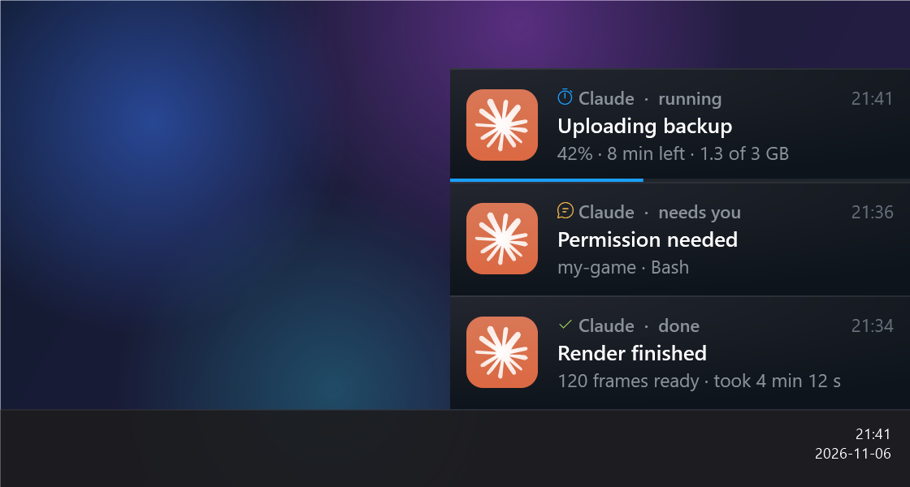
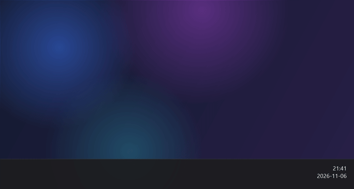

# donetoast

**A lightweight "job finished" notification for Windows, styled after Steam's friend toasts.**
When a long job finishes (a build, a render, a file move, a Claude Code or Codex task), a small card slides up from the bottom-right corner, right above the taskbar, with a soft chime.
It can also follow a job live with a progress bar and the time left, and tell you when Claude Code is waiting for your answer.





## Why

- **Works even when Windows notifications are off.** It draws its own window and does not depend on Focus Assist or the Action Center.
- **Looks right.** The size (283×70), radial background, colours, 44 px avatar and the 300 ms `cubic-bezier(0, .73, .48, 1)` slide-in were all measured from Steam's own client stylesheet.
- **Stacks with no gaps.** Several cards sit directly on top of each other, flush against the taskbar and the right edge of the screen.
- **No console flash.** Jobs are started with `ShowWindow = 0`, so no blue or black PowerShell window blinks on screen.
- **Easy on the PC.** About 1 s of CPU when a card opens, then essentially zero. Memory is trimmed after the slide-in: about 10 MB working set instead of 140 MB while the card is open (a live card trims again every 30 s), and everything is freed when you click it away.
- **A soft sound instead of the Windows ding.** The chimes are synthesized locally and kept quiet, at about −12 dBFS, with no harsh overtones.
- **Nothing to install.** It uses the PowerShell 5.1 and WPF that ship with Windows 10 and 11.

| Done | Failed |
|---|---|
|  |  |
| **Running** (live progress) | **Needs you** |
|  |  |

## Install

```powershell
git clone https://github.com/siiplasplas/donetoast "$HOME\donetoast"
```

Any folder works; the scripts find their files relative to themselves.

## Usage

Show a notification right away:

```powershell
& "$HOME\donetoast\donetoast.ps1" -Title 'Render finished' -Message '120 frames ready'
```

Show a red "failed" card:

```powershell
& "$HOME\donetoast\donetoast.ps1" -Title 'Build failed' -Message 'Exit code 1' -Failed
```

Run a long job in the background and get notified when it ends. The job keeps running even if the window that started it is closed:

```powershell
& "$HOME\donetoast\donetoast.ps1" -Title 'Backup' -Command 'robocopy D:\Photos E:\Backup /MIR'
```

When the job ends, a card reports how long it took and the free space on C:. If it fails, a red card shows the exit code and the path to the log. Each job's output goes to `jobs\<timestamp>.log`.

### Live progress

Give a job a name with `-Id` and call again with each new percentage. The first call opens a blue "running" card. Later calls only update a small state file, so they are instant and start no new process. The card works out the time left from how fast the percentage moves.

```powershell
$dt = "$HOME\donetoast\donetoast.ps1"
& $dt -Id upload -Title 'Uploading photos' -Percent 0
& $dt -Id upload -Percent 42 -Message '1.3 of 3 GB'   # -> "42% · 8 min left · 1.3 of 3 GB"
& $dt -Id upload -Done -Title 'Upload finished'       # or -Failed; the same card turns green or red
```

Without `-Percent`, the card shows the time elapsed instead. Clicking a running card hides it, and you still get a card when the job ends.

With `-Command`, add `-Progress` to get a running card from the start that turns into the result card at the end. The job can move the bar itself:

```powershell
& $dt -Title 'Convert videos' -Progress -Command @'
$files = Get-ChildItem D:\Videos\*.mov; $i = 0
foreach ($f in $files) {
  ffmpeg -i $f.FullName ($f.FullName -replace '\.mov$', '.mp4')
  $i++; & $env:DONETOAST -Id $env:DONETOAST_ID -Percent (100 * $i / $files.Count) -Message $f.Name
}
'@
```

### "Needs you" cards

`-Waiting` shows an amber card with a light double-tap sound, for when something is waiting on you:

```powershell
& "$HOME\donetoast\donetoast.ps1" -Title 'Permission needed' -Message 'my-game · Bash' -Waiting
```

| Parameter | What it does |
|---|---|
| `-Title` | Card title (with `-Command`, the job's name) |
| `-Message` | Second line |
| `-Command` | PowerShell command to run in the background; without it the card shows right away |
| `-Failed` | Red "failed" card and the lower chime |
| `-Waiting` | Amber "needs you" card |
| `-Id` | Name of a live card; later calls with the same name update it |
| `-Percent` | With `-Id`: progress from 0 to 100 |
| `-Done` | With `-Id`: turn the live card into a green "done" card |
| `-Progress` | With `-Command`: show a live card while the job runs |
| `-App` | Source name in the header, for example `Claude` or `Codex`; `icons\<name>.png` is used as the avatar |

Click a card to dismiss it. To make cards close on their own, call `toast.ps1` directly with `-Seconds 20`.

### Using it with Claude Code or Codex

**Know when Claude is waiting for you.** Add these hooks to `~/.claude/settings.json`, merged into any `hooks` you already have. A "needs you" card appears when Claude asks for permission or has been waiting for your reply. You don't have to dismiss it: the `clear` hooks remove it when you send your next message or when Claude's turn ends. When no card is open, `claude-clear.cmd` returns in about 0.1 s, so it adds no noticeable delay.

```json
{
  "hooks": {
    "Notification": [
      { "matcher": "permission_prompt|idle_prompt|elicitation_dialog",
        "hooks": [{ "type": "command", "timeout": 15,
          "command": "powershell -NoProfile -ExecutionPolicy Bypass -File \"C:/Users/YOU/donetoast/claude-hook.ps1\" notify" }] }
    ],
    "UserPromptSubmit": [ { "hooks": [{ "type": "command", "timeout": 10, "command": "C:/Users/YOU/donetoast/claude-clear.cmd" }] } ],
    "Stop":             [ { "hooks": [{ "type": "command", "timeout": 10, "command": "C:/Users/YOU/donetoast/claude-clear.cmd" }] } ]
  }
}
```

**Know when a task is done.** Add a line like this to your `CLAUDE.md` or `AGENTS.md`:

> When a long task I'm waiting for finishes (build, render, download, long test) or fails, notify me with
> `& "$HOME\donetoast\donetoast.ps1" -Title '<what>' -Message '<short result>'` (add `-Failed` on failure, `-App Codex` when you are Codex).

If the agent runs in a sandbox, it has to run this command with the sandbox turned off; otherwise the card can't open on your desktop.

## Customising

- **Icon.** Drop a 256 px PNG into `icons\` named after the `-App` value, for example `icons\myapp.png`. Apps with no icon fall back to `icon.png`.
- **Sound.** Run `make-sounds.ps1` to regenerate the chimes. Alternatives are in `sounds\`: `soft-duo` (default), `bubble`, `calm-arpeggio`, `soft-fall` (default for failures), `soft-tap` (default for "needs you"). To switch, run for example `make-sounds.ps1 -Done bubble -Wait calm-arpeggio`. Running cards make no sound.
- **README images.** Run `tools\make-previews.ps1` to rebuild `docs\`. It renders the cards off-screen onto a fake desktop and never takes a real screenshot, so nothing from your screen ends up in the images.

## Files

| File | Role |
|---|---|
| `donetoast.ps1` | Entry point: starts a hidden process for an instant card or a background job |
| `toast.ps1` | The card itself (WPF window, animation, sound) |
| `job-runner.ps1` | Runs a job and calls `toast.ps1` when it ends |
| `claude-hook.ps1`, `claude-clear.cmd` | Claude Code hooks for the "needs you" card |
| `make-sounds.ps1` | Sound synthesizer |
| `tools\` | Icon and README image generators |

Claude and Codex logos belong to Anthropic and OpenAI. They are used here only to show which app a notification came from.

## License

MIT
