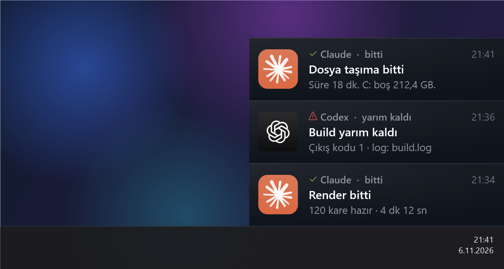
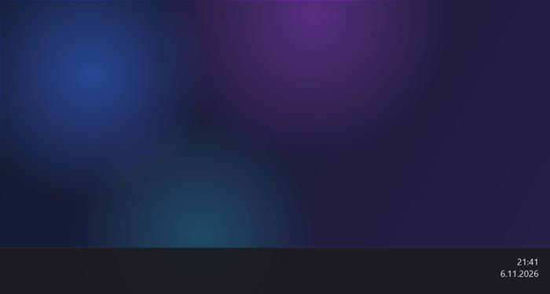

# masaustu-bildirim

**Windows için Steam'in arkadaş bildirimleri tarzında, hafif bir "iş bitti" bildirimi.**
Uzun bir iş bitince (build, render, dosya taşıma, Claude Code ya da Codex görevi) sağ altta, görev çubuğunun hemen üstünde küçük bir kart kayarak çıkar ve yumuşak bir ses çalar.

[English README](README.md)





## Neden

- **Windows bildirimleri kapalıyken de çıkar.** Kendi penceresini çizer; Odaklanma Yardımı'na ya da bildirim merkezine bağlı değildir.
- **Göze doğru durur.** Boyut (283×70), radyal arka plan, renkler, 44 px avatar ve 300 ms'lik `cubic-bezier(0, .73, .48, 1)` giriş eğrisi Steam istemcisinin kendi stil dosyasından ölçüldü.
- **Boşluksuz yığılır.** Birden fazla kart görev çubuğuna ve ekranın sağ kenarına yapışık, üst üste dizilir.
- **Konsol yanıp sönmez.** İşler `ShowWindow = 0` ile başlatılır; mavi ya da siyah PowerShell penceresi görünmez.
- **Bilgisayarı yormaz.** Kart açılırken yaklaşık 1 sn işlemci harcar, sonra neredeyse sıfır (15 sn'de ≈30 ms). Giriş animasyonundan sonra bellek boşaltılır: kart açıkken 140 MB yerine yaklaşık 40 MB tutar, tıklayıp kapatınca hepsi serbest kalır.
- **Windows "dın" sesi yerine yumuşak bir ses.** Sesler yerelde sentezlenir; seviye düşüktür (yaklaşık −12 dBFS), tiz harmonik yoktur.
- **Kurulum gerekmez.** Windows 10 ve 11 ile gelen PowerShell 5.1 ve WPF'i kullanır.

| Bitti | Yarım kaldı |
|---|---|
|  |  |

## Kurulum

```powershell
git clone https://github.com/siiplasplas/masaustu-bildirim "$HOME\.bildirim"
```

İstediğin klasöre kurabilirsin; betikler dosyalarını kendi bulundukları yere göre bulur.

## Kullanım

Hemen bildirim göstermek için:

```powershell
& "$HOME\.bildirim\arka.ps1" -Ad 'Render bitti' -Metin '120 kare hazır' -SadeceBildir
```

Kırmızı "yarım kaldı" kartı için:

```powershell
& "$HOME\.bildirim\arka.ps1" -Ad 'Build' -Metin 'Çıkış kodu 1' -SadeceBildir -Hata
```

Uzun bir işi arka planda çalıştırıp bitince haber almak için (işi başlatan pencere kapansa da iş sürer):

```powershell
& "$HOME\.bildirim\arka.ps1" -Ad 'Yedekleme' -Komut 'robocopy D:\Fotolar E:\Yedek /MIR'
```

İş bitince kart sürenin kaç dakika tuttuğunu ve C: sürücüsündeki boş alanı yazar. Hata olursa kırmızı kartta çıkış kodu ve log dosyasının yolu görünür. Her işin çıktısı `isler\<zaman>.log` dosyasına yazılır.

| Parametre | Ne yapar |
|---|---|
| `-Ad` | Kartın başlığı |
| `-Metin` | Kartın ikinci satırı |
| `-SadeceBildir` | İş çalıştırmadan sadece bildirim gösterir |
| `-Komut` | Arka planda çalıştırılacak PowerShell komutu |
| `-Hata` | Kırmızı "yarım kaldı" kartı ve daha alçak ses |
| `-Uygulama` | Başlıkta görünen kaynak adı, örneğin `Claude` ya da `Codex`; avatar olarak `ikonlar\<ad>.png` kullanılır |

Karta tıklayınca kapanır. Kartın kendiliğinden kapanmasını istersen `bildir.ps1`'i doğrudan `-Saniye 20` ile çağır.

### Claude Code ya da Codex ile kullanmak

`CLAUDE.md` ya da `AGENTS.md` dosyana şuna benzer bir satır ekle:

> Beklediğim uzun bir iş (build, render, indirme, uzun test) bitince ya da yarım kalınca bana
> `& "$HOME\.bildirim\arka.ps1" -Ad '<ne>' -Metin '<kısa sonuç>' -SadeceBildir` ile bildirim gönder (hata varsa `-Hata`, Codex isen `-Uygulama Codex` ekle).

Ajan sandbox içinde çalışıyorsa bu komutu sandbox'ı kapatarak çalıştırması gerekir; yoksa kart masaüstünde açılamaz.

## Özelleştirme

- **İkon.** `ikonlar\` klasörüne `-Uygulama` değeriyle aynı adda 256 px bir PNG koy, örneğin `ikonlar\uygulamam.png`. İkonu olmayan uygulamalar için `ikon.png` kullanılır.
- **Ses.** Sesleri yeniden üretmek için `ses-uret.ps1`'i çalıştır. Seçenekler `ses\` klasöründe: `yumusak-ikili` (varsayılan), `kabarcik`, `sakin-arpej`, `yumusak-inis` (hata için varsayılan). Değiştirmek için örneğin `ses-uret.ps1 -Bitti kabarcik` çalıştır.
- **README görselleri.** `docs\` klasörünü yeniden üretmek için `araclar\onizleme-uret.ps1`'i çalıştır. Kartları ekranda göstermeden sahte bir masaüstüne çizer, gerçek ekran görüntüsü almaz; görsellere ekranından hiçbir şey girmez.

## Dosyalar

| Dosya | Görevi |
|---|---|
| `bildir.ps1` | Kartın kendisi (WPF penceresi, animasyon, ses) |
| `arka.ps1` | Başlatıcı: iş ya da anlık bildirim için gizli bir süreç açar |
| `calistir.ps1` | İş dosyasını çalıştırır, iş bitince `bildir.ps1`'i çağırır |
| `ses-uret.ps1` | Ses sentezleyici |
| `araclar\` | İkon ve README görseli üreticileri |

Claude ve Codex logoları Anthropic ve OpenAI'ye aittir; burada yalnızca bildirimin hangi uygulamadan geldiğini göstermek için kullanılıyor.

## Lisans

MIT
